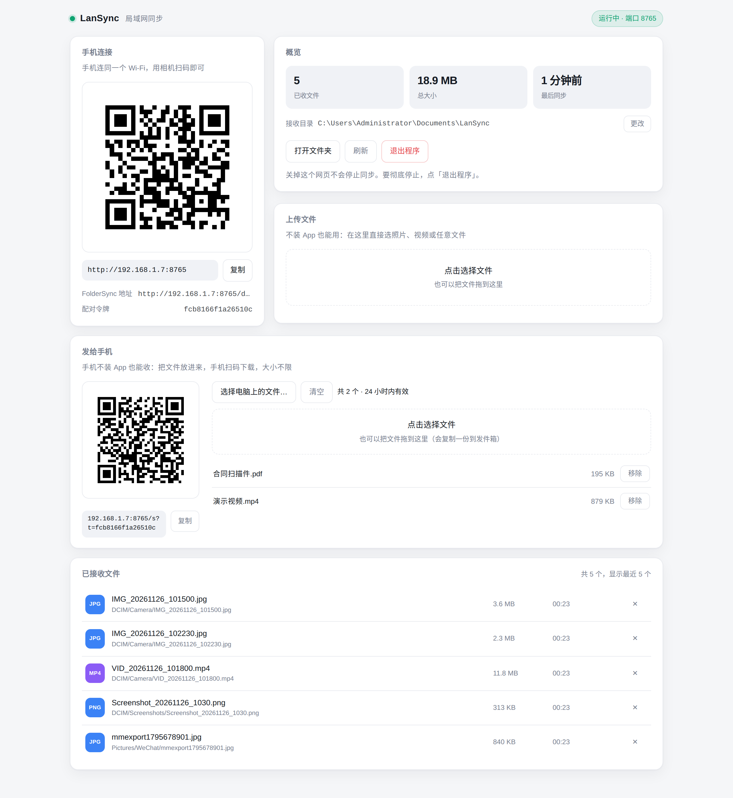

# LanSync · 局域网自动同步

[](LICENSE)
[](https://github.com/udu012/LanSync/releases)
[](#)

手机拍的照片、视频，只要连上家里同一个 Wi-Fi，就自动传到你自己的电脑上。
不经过任何云、不上传外网、不用数据线、不用点任何按钮。

反过来也能用：在电脑看板上把文件放进「发给手机」，手机扫码就能下载，大小不限、不装 App 也行。



## 下载

去 [Releases](https://github.com/udu012/LanSync/releases/latest) 取最新版：

| 文件 | 给谁用 | 说明 |
|---|---|---|
| `LanSync.exe` | 电脑 | 静默运行，双击即用，已自动加入开机启动 |
| `LanSync-console.exe` | 电脑 | 带黑窗口的控制台版，连不上时用它看日志 |
| `LanSync.apk` | 手机 | 扫码配对后自动备份（Android 8.0+） |
| `UserGuide.png` | 都看 | 一张图文长图，可以直接转发给家人 |
| `LanSync-v1.3.1.zip` | 全部 | 上面四个打成一个包 |

> GitHub 的发布附件不支持中文文件名，所以控制台版和长图在 Releases 里叫
> `LanSync-console.exe`、`UserGuide.png`，压缩包里仍是 `LanSync-控制台版.exe`、`使用说明.png`，内容一致。

一步步怎么做，看 [使用说明](docs/使用说明.md)。

- 电脑端：一个 `LanSync.exe`，6 MB，免安装，双击即用，后台静默运行
- 手机端：一个 `LanSync.apk`，扫码配对，装完就不用再管
- 同步完：电脑右下角弹通知「已接收 N 个文件」，手机通知栏也会提示

---

## 一、电脑端怎么用

1. 把 `LanSync.exe` 放到一个固定目录，比如 `D:\LanSync\`
2. 双击运行。**第一次会弹 Windows 防火墙提示，勾选「专用网络」并允许**（不点允许，手机就连不上）
3. 浏览器会自动打开看板，上面有二维码 —— 用手机扫它
4. 程序没有窗口，在后台静默运行，并已自动加入开机启动

看板上能做这些事：

| 功能 | 说明 |
|---|---|
| 二维码 | 手机扫码配对，扫一次永久记住 |
| 概览 | 已收文件数、总大小、最后同步时间 |
| 打开文件夹 | 直接跳到接收目录 |
| 更改接收目录 | 点一下弹出文件夹选择框，换到别的盘或移动硬盘；已有文件可一并搬过去 |
| 切换网络地址 | 电脑有多个网卡（如同时连着路由器和手机热点）时，点一下换掉二维码里的地址 |
| 发给手机 | 选文件或拖文件进看板，生成二维码，手机扫码就能下载（见本节末尾） |
| 退出程序 | 不想让它跑了就点这里（不用去任务管理器） |

> 重复双击 `LanSync.exe` 不会多开一个进程——它会发现已经在运行，直接把看板打开。
> 关掉浏览器网页也不会停止同步，要彻底停止请点「退出程序」。

默认接收目录：`文档\LanSync\DCIM\Camera\IMG_0421.jpg`（照搬手机相册的目录结构，找文件跟手机里一样）

程序目录里还会生成三个文件：

- `config.json` —— 端口、接收目录、访问令牌，可手动改
- `index.json` —— 已收文件清单（哈希），删掉它不会丢文件，只是下次会重新核对一遍
- `outbox.json` —— 发件箱清单（只有「发给手机」用过才会有）
- `lansync.log` —— 运行日志，出问题时看这里

命令行参数（一般用不到）：

```
LanSync.exe -port 8765 -dir "D:\我的备份" -no-notify
LanSync.exe -test-toast          测试系统通知是否正常
LanSync-控制台版.exe              带黑窗口的版本，排查问题时用
```

### 顺便：电脑也能给手机发文件

看板中间有一张「发给手机」的卡片，是反方向用的，**手机不装 App 也能收**：

1. 点「选择电脑上的文件…」，弹 Windows 文件框，按住 Ctrl 多选；或者直接把文件拖到虚线框里
2. 卡片左边立刻出现二维码和一条链接
3. 手机连同一个 Wi-Fi，扫码（或把链接发到手机浏览器打开），看到文件列表，点「下载」

几个要知道的点：

- **大小不限**。服务器是边读边发，传 20GB 也不占内存；链接支持断点续传，下载断了重新点会接着来。
- **两种放文件方式的区别**：用「选择电脑上的文件」是原地共享，不复制、不占双倍空间，但你之后把那个文件挪走或删掉，链接就失效了（手机上会显示「原文件不在了」）；拖进虚线框的会复制一份到程序目录的 `outbox\` 里，不怕原文件被动。
- **24 小时后自动失效**，清的是链接和副本，你自己的原文件一根毫毛都不会动。
- 手机上：安卓存到「文件管理 → 下载」；iPhone 进「文件」App，需要手动存到相册。

> 收文件这个方向没法规避一个前提：手机不装 App 就没法后台自动收，每次都得扫码点一下。

---

## 二、手机端怎么用

1. 安装 `LanSync.apk`（首次需要允许「安装未知来源应用」）
2. 打开 App，授予「照片和视频」权限
3. 点 **扫描电脑二维码**，对准电脑屏幕
4. 配对成功后会自动跑一次同步。之后只要连上家里 Wi-Fi，就会自动传

**必须做的一步（否则后台会被系统杀掉）：**

- 系统设置里允许 LanSync **自启动 / 后台运行**
- 电池策略设为 **不限制 / 允许后台高耗电**
- 小米、OPPO、vivo、华为把这几个开关藏得比较深，App 里点「自动备份」时会跳转到电池设置页

App 主界面就这几样，没有别的：

- 扫描电脑二维码
- 立即同步（想马上传的时候点一下）
- 自动备份：开 / 关
- 备份范围（可选，见下）
- 使用说明（图文步骤，装在 App 里，不联网，双指能放大）

### 只想备份某几个相册

手机相册里混着微信存下来的图、截图、各种 App 的缓存图，全传上去会乱。
点主界面的 **备份范围**，会列出手机上所有相册（相机、截屏、微信、下载……），
每个后面一个开关，关掉的不再传。

- 默认全开，跟以前一样；新装的 App 多出新相册也自动纳入，不用再回来勾
- 关掉只是「以后不传」，**电脑上已有的文件不会被删**
- 重新打开也不会重传——电脑端按路径认人，传过的直接跳过
- 一个都不选时 App 会提醒一句，但不拦着你（也许你就想彻底停一阵）

---

## 三、手机开热点也能用

没有路由器、出差、临时环境，用手机开热点给电脑，同样能同步——手机热点本身就是一个局域网，
两者在同一网段，传文件只在热点内部转发，**不消耗手机流量**。

三个要点：

1. **电脑连上热点后，Windows 会问「是否允许此电脑被其他设备发现」→ 必须选「是」。**
   选「否」等于把网络设为「公用」，防火墙会直接拦掉 8765 端口，症状是扫码后一直连不上。
2. **电脑同时连着别的网络时，二维码可能指向手机到不了的地址。**
   看板会列出电脑所有网络地址，点标着「手机热点」的那个，二维码会重新生成，再扫一次。
3. **每次重开热点，电脑 IP 可能变**，重新扫一次码即可。

## 四、它是怎么做到「无感」的

每次同步前，手机会把本地照片清单（路径 + 大小 + 修改时间）一次性报给电脑，
电脑回一句「这 3000 张我都有了，只有这 12 张是新的」，手机就只传这 12 张。

| 层次 | 机制 | 作用 |
|---|---|---|
| 快筛 | 路径 + 大小 + 修改时间 | 秒级跳过已同步文件，零流量 |
| 强校验 | 电脑端落盘时算 SHA-256 | 防止大小一样但内容截断/损坏 |
| 去重 | 服务端维护哈希清单 | 同一张照片重复传只留一份 |

传输本身是流式的：边收边写临时文件，收完才原子改名。
中途断网、手机没电，都不会在电脑上留下半个坏文件。

---

## 五、常见问题

**手机扫码后连不上？**

1. 手机和电脑是不是连的同一个 Wi-Fi（不是手机流量、不是访客网络）
2. 电脑防火墙有没有放行（第一次运行时那个弹窗点了「允许」吗）
3. 路由器是否开了「AP 隔离 / 访客网络隔离」，开了就会挡住设备互访
4. 电脑 IP 变了（路由器重新分配）—— 重新扫一次二维码即可

**手机后台不同步？**
基本都是系统省电策略把 App 杀了。按上面第二步把「自启动」和「电池不限制」打开。
判断方法：手动点一次「立即同步」，如果能传，说明就是后台被限制了。

**想换接收目录？**
看板「概览」里点「更改」，弹窗里选个文件夹就行，不用改配置也不用重装。
如果当前已经有文件，会问你要不要一起搬到新位置——搬的话新位置就是完整的一份，
不搬的话旧文件留在原处。切换后手机会自动对上号，不会把老照片重传一遍。

也可以改 `config.json` 里的 `dir`，或者用 `-dir` 参数启动（需要重启程序）。

**端口被占用？**
会自动往后找可用端口（8765 → 8766 …），看板上显示的就是实际端口，二维码也会跟着变。

**不想装 App，能用吗？**
能。电脑端内置了 WebDAV 服务，手机装免费的 FolderSync，服务器类型选 WebDAV，
地址填看板上的 `http://电脑IP:端口/dav`，用户名随便填，密码填看板上的「配对令牌」，
然后设定「连接家庭 Wi-Fi 时自动上传相机目录」即可。
也可以直接用手机浏览器扫二维码，在网页里手动选文件上传。

---

## 六、安全说明

- 只监听局域网，不对外网开放，也不需要任何账号
- 局域网内访问需要令牌（在 `config.json` 里，可自己改成一串复杂字符）
- 所有文件直接落你自己硬盘，不经过任何第三方服务器
- 同一张照片被重复上传时不会产生多份，但**同步不是备份**：建议再定期把接收目录复制到移动硬盘

---

## 七、自己编译

电脑端（Go 1.21+）：

```bash
cd server
go build -ldflags "-s -w -H windowsgui" -o LanSync.exe .
```

手机端（Android Studio 打开 `app/` 目录，或命令行）：

```bash
cd app
gradle assembleDebug
# 产物：app/build/outputs/apk/debug/app-debug.apk
```

也可以用 GitHub Actions 自动打包：把仓库推到 GitHub，
`.github/workflows/build-apk.yml` 会自动编译并上传 APK 产物。

正式分发前请把 `app/app/build.gradle.kts` 里的签名换成你自己的 keystore。

---

## 八、目录结构

```
LanSync/
├─ dist/                       发布产物（不进仓库，走 Releases）
│  ├─ LanSync.exe              电脑端（静默版）
│  ├─ LanSync-控制台版.exe      电脑端（带窗口，排错用）
│  ├─ LanSync.apk              手机端
│  └─ 使用说明.png              图文长图
├─ server/                     电脑端源码（Go，标准库 + 一个二维码库）
│  ├─ main.go                  服务、接口、鉴权、通知、开机自启
│  ├─ store.go                 落盘、哈希、索引、路径安全
│  ├─ outbox.go                「发给手机」的发件箱
│  ├─ dav.go                   WebDAV 兜底
│  ├─ pick_windows.go          系统文件/文件夹选择框
│  └─ web/
│     ├─ index.html            看板界面（内嵌进 exe）
│     └─ send.html             手机收件页（内嵌进 exe）
├─ app/                        手机端源码（Kotlin，原生 View，不用 Compose）
│  └─ app/src/main/
│     ├─ java/com/lansync/app/
│     │  ├─ MainActivity.kt    主界面
│     │  ├─ AlbumActivity.kt   备份范围（相册勾选）
│     │  ├─ GuideActivity.kt   内置使用说明（WebView）
│     │  ├─ SyncEngine.kt      扫描 → 核对 → 只传差异
│     │  ├─ MediaScanner.kt    读媒体库，照搬手机目录结构
│     │  ├─ Albums.kt          相册聚合与排除名单
│     │  ├─ WatchService.kt    常驻守护，拍完照自动备份
│     │  └─ SyncWorker.kt      后台定时任务（兜底）
│     └─ assets/guide/         使用说明页（HTML + WebP，约 300 KB）
├─ docs/
│  ├─ 使用说明.md              图文步骤（就是长图的文字版）
│  └─ tutorial/                长图源文件、配图、重新出图方法
├─ AGENTS.md                   给接手的人：架构、接口、踩过的坑
└─ LICENSE                     MIT
```

---

## 九、开源许可

[MIT License](LICENSE) —— 随便用、随便改、商用也行，保留版权声明即可。

用到的第三方组件：

| 组件 | 用途 | 许可 |
|---|---|---|
| [skip2/go-qrcode](https://github.com/skip2/go-qrcode) | 生成配对二维码 | MIT |
| [zxing-android-embedded](https://github.com/journeyapps/zxing-android-embedded) | 手机扫码 | Apache-2.0 |
| AndroidX / Material Components | 界面 | Apache-2.0 |
| OkHttp | 手机端 HTTP | Apache-2.0 |

> 手机端目前用 debug 签名，方便直接安装体验。自己发布前请换成自己的 keystore——
> 换签名会让已装的 App 无法覆盖升级（配对信息要重扫一次码）。

## 十、其它文档

- [使用说明](docs/使用说明.md) —— 装、配对、保活、排查、备份范围
- [AGENTS.md](AGENTS.md) —— 接手开发先看这个：协议、约束、别踩的坑
- [docs/tutorial](docs/tutorial) —— 长图源文件与重新出图步骤
