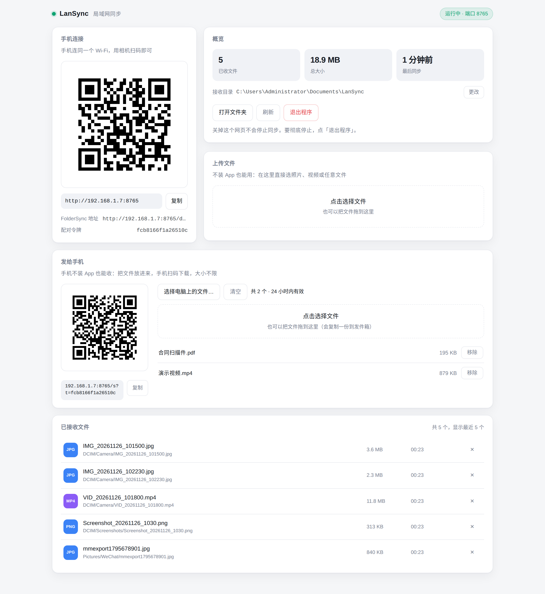
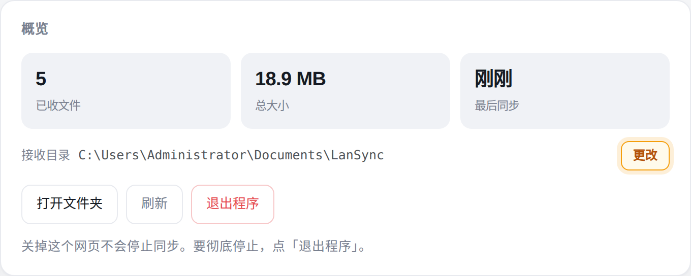
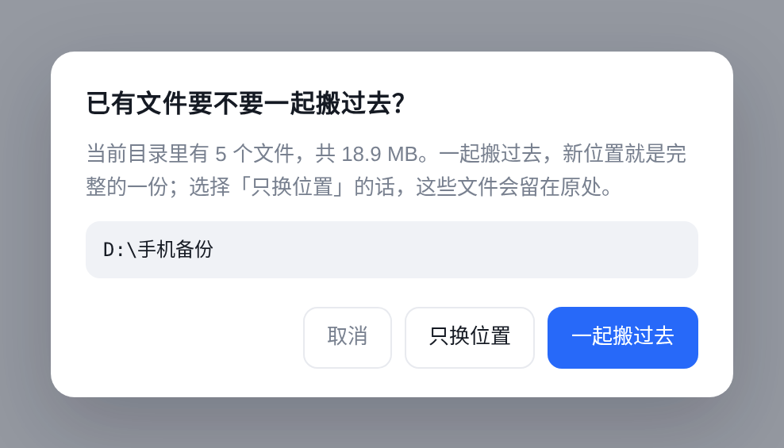
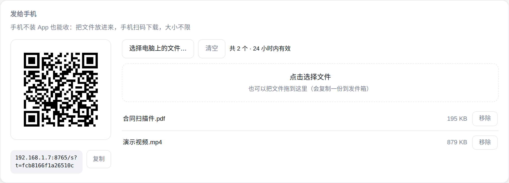
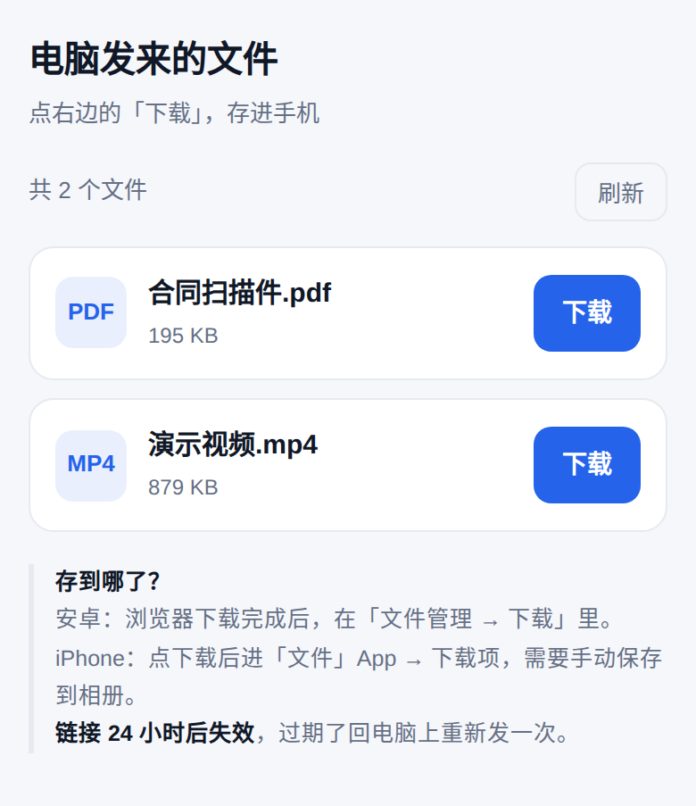

# LanSync 使用说明

手机连上家里同一个 Wi-Fi，照片和视频就自动传到自己的电脑上。
不用数据线、不用点按钮、不经过任何云盘。

这份说明按「第一次装」的顺序写，跟着做一遍就行。**第二节最关键，装好就改**。

> 想看图文长图版：从 [Releases](https://github.com/udu012/LanSync/releases) 下载 `使用说明.png`。
> App 里也内置了同一份说明（主界面底部「使用说明」）。

---

## 一、先在电脑上装好

只需要做一次，以后开机自动运行。

### 1. 把程序放到一个固定的文件夹

解压后，把 `LanSync.exe` 放到 `D:\LanSync\` 这类你找得到的位置。

不要放在 `C:\Program Files`，那里没有写入权限，程序会存不下日志和配置。

程序本身只占几 MB，放哪都不影响；但**它收到的照片存在哪，下一节要单独改一次**。

### 2. 双击运行，然后允许防火墙

程序没有窗口，双击后就在后台跑起来了，并且已经自动加入开机启动。

第一次会弹「Windows 安全中心防火墙」提示：勾选 **专用网络** → 点 **允许访问**。

> ⚠️ 这一步一定要点允许。点了「取消」的话，手机一定连不上，而且不会再弹第二次。

### 3. 浏览器会自动打开看板

看板最左边就是二维码，等下用手机扫它。右边能看到已收文件数、总大小和接收目录。

> 重复双击 `LanSync.exe` 不会多开一个程序，只会把看板再打开一次。
> 关掉网页也不会停止同步——要彻底停止，点看板上的「退出程序」。



*电脑上打开的看板：左边二维码，右边概览，中间是上传口和「发给手机」，最下面是收到的文件*

---

## 二、第一件事：把接收目录挪出 C 盘

**装好就改，别等 C 盘满了再搬。**

照片和视频只会越来越多，一年几十 GB 很平常。默认存在 C 盘的用户「文档」里，等 C 盘快满了，系统变慢、更新失败、软件装不上，全跟着来。所以**装好后的第一件事，就是把它指到 D 盘或 E 盘**。

> ⚠️ 这一步**越早做越省事**。已经有几千张照片时再换，程序要把文件一个个搬过去，C 盘到 E 盘属于跨盘复制，得等一会儿；一个空目录换起来是一瞬间的事。



*「概览」里，接收目录后面那个橙色的「更改」*

### 1. 点「更改」，挑一个新文件夹

会弹出 Windows 自带的文件夹选择框，直接选个位置就行，比如 `D:\手机备份`、`E:\照片存档`。没有的文件夹可以当场新建。

弹不出选择框（少数精简版系统），弹层里也能**直接粘贴路径**，效果一样。

### 2. 已经有文件时，它会问你要不要一起搬



- 选 **一起搬过去**：旧文件全部挪到新位置，新位置就是完整的一份。同一个盘内几乎瞬间完成；跨盘（比如从 C 到 E）要按文件大小等一会儿，这期间别关页面。
- 选 **只换位置**：以后收到的东西存到新位置，旧文件留在原地不动。

> 💡 换完之后手机会自动对上号，**不会把老照片重传一遍**。想换回去，再点一次「更改」选回原来的文件夹就行。

**可以选**：D 盘 / E 盘下的任意普通文件夹、移动硬盘、U 盘、能正常写入的 NAS 挂载盘

**不要选**：C 盘（尤其「桌面」「下载」「文档」这三个最占地方）、`C:\Program Files`（没写入权限，程序存不下配置）

**经常拔的盘要留意**：接收目录在移动硬盘上时，盘拔了同步就会失败，插回来才恢复。长期用建议选内置硬盘。

---

## 三、手机扫码配对

配对一次，永久记住。

### 1. 安装 LanSync.apk

把 apk 传到手机上点安装。系统提示「禁止安装未知来源应用」时，去设置里允许一次即可。

### 2. 允许「照片和视频」权限

打开 App，按提示同意。不给这个权限，App 扫不到任何照片。

### 3. 扫描电脑上的二维码

点 **扫描电脑二维码**，把手机对准电脑屏幕上的二维码。

配对成功后会立刻同步一次。之后**每拍一张照片、录一段视频**，十几秒内电脑上就能看到，不用手动点。

（二维码在电脑看板左侧。）

---

## 四、这两个开关一定要打开

否则同步会在后台被系统悄悄掐断。

### 1. 允许 LanSync 自启动 / 后台运行

在手机的「设置 → 应用管理 → LanSync」里，把「自启动」「后台运行」打开。

### 2. 电池策略设为「不限制」

同一个页面里把电池/耗电管理改成 **不限制** 或 **允许后台高耗电**。

> ⚠️ 小米、OPPO、vivo、华为把这几个开关藏得比较深。App 里点「自动备份」时会直接跳到电池设置页，跟着走就行。

这是安卓系统的省电机制，不是软件的问题。绝大多数「装了但没同步」都是这里没设。

---

## 五、怎么确认传成功了

三个地方都能看到：

- 电脑右下角弹通知：**已接收 N 个文件 · XX MB**
- 手机通知栏出现一条 **备份完成**
- 文件躺在**第二节你设的那个目录**里：`D:\手机备份\DCIM\Camera\`（目录结构和手机相册一样）

> 💡 同一次同步里重复的照片只会存一份，不会越传越多。

---

## 六、连不上？按这个顺序查

九成问题在前两条。

1. **手机和电脑是不是同一个 Wi-Fi？** 不能是手机流量，也不能是「访客网络」。
2. **防火墙放行了吗？** 回想第一次那个弹窗，点了「允许」没有。
3. **路由器开了「AP 隔离 / 访客隔离」** 会挡住设备互访，去路由器后台关掉它。
4. **换了网络，电脑 IP 会变。** 重新扫一次二维码就好，不用重装。
5. **还是不行？** 换用 `LanSync-控制台版.exe` 启动，窗口里会直接打印它探测到的「手机地址」，对照手机能不能打开这个地址。

---

## 七、没有路由器？手机开热点也能用

出差、租房、临时环境都适用。

手机开热点、电脑连上，两者就处在同一个局域网。传文件只在热点内部转发，**不消耗手机流量**。

> ⚠️ 电脑连上热点后，Windows 会问「是否允许此电脑被其他设备发现」——必须选 **是**。选「否」等于把网络设为「公用」，防火墙会拦掉连接。

> 💡 如果电脑同时插着网线或连着别的 Wi-Fi，二维码可能指向手机到不了的地址。这时看板会多出一排「网络地址」按钮，点标着 **手机热点** 的那个，二维码会重新生成，再扫一次即可。

---

## 八、反过来：电脑也能把文件发给手机

手机不装 App 也能收，大小不限。

看板中间那张「发给手机」的卡片就是干这个的。它和前面几节方向相反，但用的是同一条连接，不用多配任何东西。



*左边是给手机扫的二维码，右边是你放进去的文件*

### 1. 把文件放进发件箱

点 **选择电脑上的文件…**，弹出 Windows 的文件框，按住 Ctrl 可以一次选好几个。

也可以直接把文件**拖**到虚线框里。区别是：选择框是「原地共享」，不复制、不占第二份空间；拖进去的会复制一份到程序目录的 `outbox` 里，不怕原文件被挪走。

### 2. 手机扫码，点下载

手机连同一个 Wi-Fi，用相机扫左边那个二维码，会打开一个只有文件列表的页面。



*手机上看到的样子：文件名、大小、一个下载按钮*

点 **下载** 就开始传，进度条在浏览器里。安卓存进「文件管理 → 下载」；iPhone 会进「文件」App，想进相册得自己再保存一次。

> 💡 **大小不限**：程序是边读边发，传 20GB 也不占内存。下载断了不要紧，重新点一次会**接着上次的位置继续**，不用从头来。

> ⚠️ 发件箱里的东西 **24 小时后自动失效**，清掉的只是链接和拖拽产生的副本，你自己电脑上的原文件一根毫毛都不会动。想提前清空，点卡片上的「清空」。

---

## 九、只想备份某几个相册

手机相册里混着微信存下来的图、截图、各种 App 的缓存图，全传上去会乱。

点主界面的 **备份范围**，会列出手机上所有相册，每个后面一个开关，关掉的不再传。

- 列表按体积从大到小排，每行写着「相册名 / 完整路径 · 几个 · 多大」，同名相册（比如两个「微信」）靠路径区分
- 顶部有 **全选 / 全不选**，右边实时显示「已选 21 / 23」
- **默认全开**，跟以前一样；新装的 App 多出新相册也自动纳入，不用再回来勾
- 关掉只是「以后不传」，**电脑上已有的文件不会被删**
- 重新打开也不会重传——电脑端按路径认人，传过的直接跳过
- 一个都不选时会提醒你，但不拦着（也许你就想彻底停一阵）

常见的相册名会自动翻译成中文：相机、截屏、录屏、微信、QQ、微博、下载……

> 💡 微信保存的图一般在 `Pictures/WeChat`，部分机型在 `DCIM/WeChat`，两个都认。
> `Android/data` 下面那些微信缓存图系统不让任何 App 读，不会出现在列表里，也不会被备份。

---

## 附：文件都在哪

接收目录（第二节设的那个）里，就是手机相册的原样结构：

```
D:\手机备份\
├─ DCIM\Camera\IMG_20261126_101500.jpg
├─ DCIM\Screenshots\Screenshot_20261126_1030.png
└─ Pictures\WeChat\mmexport1795678901.jpg
```

程序目录里还有几个文件：

| 文件 | 作用 |
|---|---|
| `config.json` | 端口、接收目录、访问令牌，可手动改 |
| `index.json` | 已收文件清单，删掉不会丢文件，只是下次重新核对一遍 |
| `outbox.json` | 发件箱清单（用过「发给手机」才有） |
| `lansync.log` | 运行日志，出问题先看这里 |

---

所有文件只存在你自己的硬盘上，不经过任何第三方服务器。
局域网内访问需要配对令牌，可在 `config.json` 中修改。

**同步 ≠ 备份**：重要资料建议再复制一份到移动硬盘。
